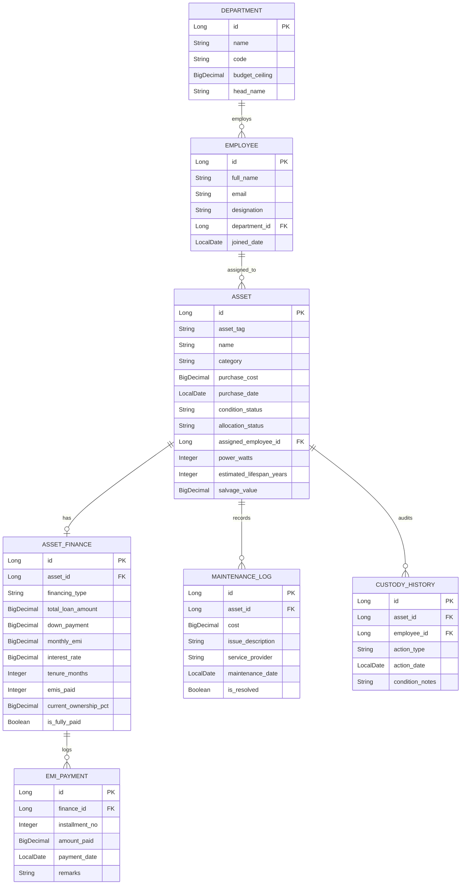

# CODESPARK HACKATHON 2026
### KL University – Bachupally Campus • In Association with Yellowspot Technologies
## Problem Statement 28: Corporate Asset Management (Track 4 — Workforce & Enterprise)

---

## 📌 Executive Summary
**Corporate Asset Management (Problem Statement 28)** is a full-stack enterprise platform that bridges **Hardware Operations**, **CapEx Finance**, **Inflation Forecasting**, and **ESG / Green IT Sustainability**.

Rather than functioning as a basic inventory checklist, this platform models the true financial and operational lifecycle of enterprise equipment:
1. **Physical Asset & Custody Tracking:** Full lifecycle management for laptops, cloud servers, EV fleet delivery vans, and office workstations mapped to employee headcount.
2. **Loan Financing & Dynamic Equity Engine:** Tracks equipment debt, monthly EMIs, and recalculates company asset equity in real-time as installments are paid.
3. **Interactive Early Payoff ROI Simulator:** Simulates lump-sum pre-payments to show months saved off loan tenure and net bank interest saved.
4. **CapEx Time-Machine (Inflation & Replacement):** Backtracks historical purchase value, compares today's depreciated book value against current replacement costs (**The Replacement Deficit**), and forecasts 5-year replacement budgets using the visual **Scissors Chart**.
5. **Department "Cost-Per-Seat" & Quotas:** Automatically computes $(\text{Total Asset Value} / \text{Headcount})$ per department and enforces budget ceilings.
6. **Green IT & ESG Carbon Analytics:** Calculates active wattage draw, monthly kWh consumption, electricity utility expenditure, and carbon emissions ($kg\text{ CO}_2$) with eco-efficiency grades.
7. **Proactive Smart Alerts:** Automated business rules that flag **"Scrap vs. Repair" tipping points** (when cumulative repairs exceed 50% of an asset's book value) and budget ceiling breaches.
8. **Python AI Innovation Microservice:** FastAPI service predicting 6-month expenditure spikes and hardware failure probabilities.

---

## 🛠️ Technology Stack
* **Backend:** Java 21 / 24, Spring Boot 3.3.4, Spring MVC REST APIs, Spring Data JPA, Hibernate.
* **Database:** MySQL / PostgreSQL (configured with H2 in-memory zero-configuration dev mode).
* **Frontend:** React 18, Vite, Lucide Icons, Custom High-Performance Modern CSS.
* **AI/ML Service:** Python 3 (FastAPI, Scikit-learn, NumPy).
* **External Integrations:** Live Forex Exchange API (`open.er-api.com`) with dynamic USD ($), INR (₹), and EUR (€) toggle.

---

## 🏗️ Architecture & Data Model



---

## 🚀 One-Click Quick Start (Windows)

You can launch all 3 microservices simultaneously using the master runner:

```powershell
cd C:\Users\aakas\.gemini\antigravity\scratch\corporate-asset-management
.\start-all.bat
```

Or run them individually:

### 1. Python ML Microservice (Port 8000)
```powershell
cd ml-service
.\run-ml.bat
```
* Swagger Docs: [http://localhost:8000/docs](http://localhost:8000/docs)

### 2. Java Spring Boot Backend (Port 8080)
```powershell
cd backend
.\run-backend.bat
```
* Automatically bootstraps portable Maven wrapper (no global Maven installation required!).
* Database Console: [http://localhost:8080/h2-console](http://localhost:8080/h2-console) (JDBC URL: `jdbc:h2:mem:camdb`)

### 3. React Frontend (Port 5173)
```powershell
cd frontend
.\run-frontend.bat
```
* Web Application: [http://localhost:5173](http://localhost:5173)

---

## 📡 REST API Endpoint Contracts

| Method | Endpoint | Description |
| :--- | :--- | :--- |
| `GET` | `/api/dashboard/summary` | Executive headline KPIs, debt-to-equity ratio, monthly cash burn, and live forex rates |
| `GET` | `/api/dashboard/cost-per-seat` | Department headcount, allocated assets, cost per seat, and budget ceiling utilization |
| `GET` | `/api/dashboard/category-distribution`| Asset breakdown by category (Hardware, Server, Vehicle, etc.) |
| `GET` | `/api/assets` | Retrieve all physical corporate assets |
| `POST`| `/api/assets` | Register a new asset with optional loan financing |
| `POST`| `/api/assets/{id}/assign` | Assign asset to employee and record custody handover audit trail |
| `POST`| `/api/assets/{id}/return` | Return asset from employee back to company IT pool |
| `POST`| `/api/assets/{id}/maintenance` | Log a maintenance/repair expense |
| `GET` | `/api/assets/{id}/inflation` | Compute past purchasing power, present deficit, and future 5-year replacement forecast |
| `GET` | `/api/finances` | Retrieve all financed assets and equity ownership progression |
| `POST`| `/api/finances/{id}/record-emi` | Pay monthly installment; reduces debt and dynamically increases ownership % |
| `GET` | `/api/finances/{id}/simulate-early-payoff?lumpSum=...` | Calculate tenure acceleration and bank interest saved |
| `GET` | `/api/alerts` | Proactive alerts (Scrap vs. Repair triggers, budget overruns, capitalized loans) |
| `GET` | `/api/analytics/forecast` | Returns Python ML 6-month predictive expenditure trendline |
